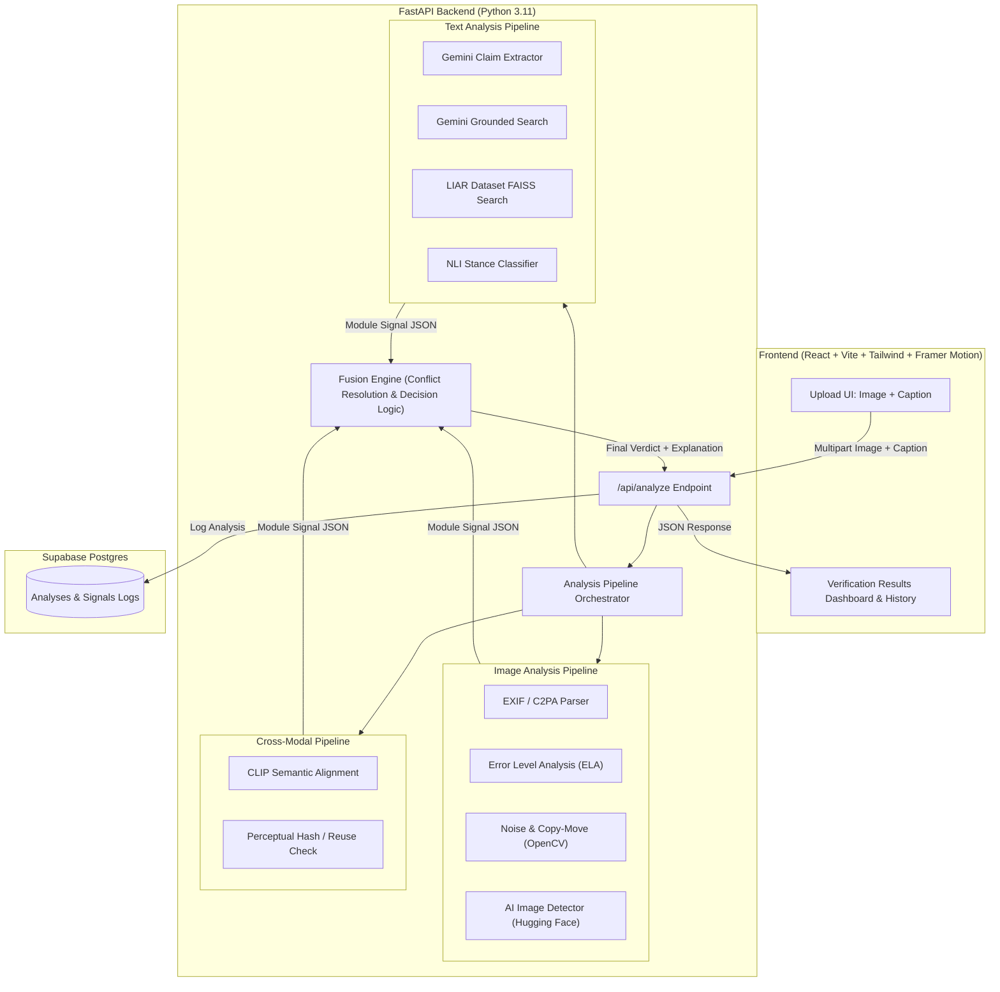
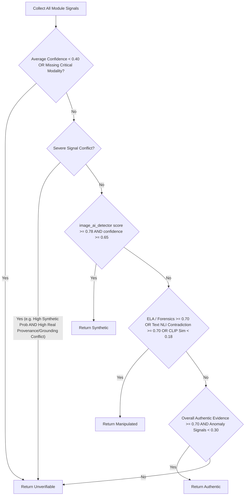

# System Specification: Multimodal Content Authenticity System

## 1. Project Goal & High-Level Overview

The **Multimodal Content Authenticity System** is a verification platform designed to evaluate news and social media content consisting of an image paired with a caption or claim. 

The system assesses both modalities—visual and textual—alongside their cross-modal alignment to assign one of four verifiable labels:
- **`Authentic`**: Content exhibits genuine provenance, matching image-text semantics, absence of digital tampering, and factually corroborated text claims.
- **`Manipulated`**: Image displays localized forensic tampering (splicing, copy-move, compression anomalies) or out-of-context caption mismatch (image re-use / cheapfake).
- **`Synthetic`**: Image displays statistical patterns and artifacts indicative of generative AI models (diffusion models, GANs).
- **`Unverifiable`**: Signal conflict, insufficient evidence, low sensor confidence, or uncorroborated assertions. The system prioritizes honesty over false certainty.

Every completed analysis is permanently persisted to Supabase Postgres to enable historical auditability, review, and dataset evaluation.

---

## 2. Scope & Boundaries

### 2.1 In Scope
- **Input Pair**: Exactly one image file (`.jpg`, `.jpeg`, `.png`, `.webp`) + textual caption / claim string.
- **Multimodal Analysis**:
  - Image forensic indicators (Metadata/EXIF/C2PA, Error Level Analysis, noise variance / copy-move patterns, AI generation classifier).
  - Textual claim verification (Claim extraction, Gemini with Google Search grounding, local LIAR dataset FAISS similarity, NLI stance detection).
  - Cross-modal consistency (CLIP semantic embedding alignment, perceptual hash image reuse).
- **Explainability**: Each individual module produces an explicit score, confidence, and human-readable explanation.
- **Transparent Uncertainty**: Explicit conflict detection and low-confidence gating leading to `Unverifiable`.
- **Persistence & Dashboard**: Storage of every inspection and a web interface displaying signal breakdown, radar/confidence bars, and explanation notes.

### 2.2 Out of Scope
- Video or multi-frame media analysis.
- Multi-page document / PDF verification.
- Real-time social media crawling or live stream ingestion.
- Paid APIs / proprietary cloud AI services outside the free tier.

---

## 3. System Architecture



---

## 4. Per-Module Input & Output JSON Contracts

Each detection module implements an isolated interface adhering strictly to the contract schema below.

### 4.1 Standard Signal Output Contract
Every module returns:
```json
{
  "module_name": "string",
  "score": 0.85,           // Normalized float between 0.0 (safe/authentic) and 1.0 (anomalous/tampered/synthetic)
  "confidence": 0.90,      // Normalized float between 0.0 (uncertain) and 1.0 (highly certain)
  "verdict_contribution": "Authentic" | "Manipulated" | "Synthetic" | "Neutral",
  "explanation": "Human-readable summary of signal findings",
  "details": {}            // Key-value dictionary containing module-specific metrics
}
```

### 4.2 Module Specifications

| Module | Purpose | Model / Algorithm | Output `details` specifics |
| :--- | :--- | :--- | :--- |
| **`image_metadata`** | Check EXIF tags, software signatures, editing software traces, and C2PA manifests. | Pillow, `piexif`, raw binary inspection. | `{"has_exif": bool, "software": str, "camera_make": str, "c2pa_manifest_detected": bool, "warnings": []}` |
| **`image_ela`** | Detect compression inconsistencies from resaved or spliced regions. | Custom PIL difference at 90-95% JPEG quality resave. | `{"mean_error": float, "max_error": float, "high_discrepancy_clusters": int}` |
| **`image_forensics`** | Detect noise pattern breaks and potential copy-move duplication. | OpenCV (Laplacian variance, Keypoint matching / SIFT/ORB). | `{"noise_variance": float, "duplicate_keypoint_clusters": int}` |
| **`image_ai_detector`** | Probability of image being synthetically generated by diffusion/GAN. | Pretrained HF ViT/ResNet (e.g. `umm-maybe/AI-image-detector`). | `{"synthetic_prob": float, "authentic_prob": float, "model_id": str}` |
| **`crossmodal_clip`** | Semantic correlation between visual elements and caption claims. | `openai/clip-vit-base-patch32` cosine similarity. | `{"cosine_similarity": float, "similarity_percentile": float}` |
| **`crossmodal_phash`** | Detect known viral image reuse and calculate visual fingerprint. | `imagehash` (dHash, aHash, pHash). | `{"phash": str, "known_reuse_flag": bool}` |
| **`text_claim_extraction`** | Extract checkable atomic claims from the user caption. | Google Gemini API (`gemini-2.5-flash` or current free tier). | `{"claims": ["claim 1", "claim 2"], "category": str}` |
| **`text_fact_check`** | Retrieve corroborating evidence via search grounding & local index. | Gemini with Google Search tool + local FAISS index on LIAR benchmark. | `{"search_sources": [], "liar_matches": [{"statement": str, "label": str, "distance": float}], "consensus": str}` |
| **`text_nli`** | Stance classification of claim vs retrieved evidence. | HF NLI model (e.g. `roberta-large-mnli` / `cross-encoder/nli-distilroberta-base`). | `{"entailment": float, "neutral": float, "contradiction": float}` |

---

## 5. Fusion Engine & Decision Logic

The fusion engine synthesizes signals into one unified output while strictly enforcing uncertainty boundaries.

### 5.1 Final Verdict Classes
1. **`Authentic`**
2. **`Manipulated`**
3. **`Synthetic`**
4. **`Unverifiable`**

### 5.2 Fusion Rules & Gating Hierarchy



### 5.3 Conflict Resolution Rules
- **Rule 1 (Honesty Gate)**: If the mean confidence of relevant signals is below `0.45`, or if contradictory strong signals exist (e.g., text verified true with strong evidence, but image AI detector flags `0.92` synthetic; or image has authentic EXIF camera metadata but ELA reveals distinct splicing), the system flags **Signal Conflict** and outputs `Unverifiable`.
- **Rule 2 (Synthetic Priority)**: If visual synthetic probability $\ge 0.78$ with confidence $\ge 0.65$ and no conflicting camera raw provenance exists, classify as `Synthetic`.
- **Rule 3 (Manipulated / Out-of-Context Priority)**:
  - If ELA/Forensics detect splicing/copy-move: mark as `Manipulated (Visual Tampering)`.
  - If CLIP similarity $< 0.18$ or NLI detects contradiction with factual ground truth: mark as `Manipulated (Context Inconsistency / Cheapfake)`.
- **Rule 4 (Authentic Threshold)**:
  - No synthetic anomalies detected ($< 0.25$).
  - No visual tampering detected ($< 0.30$).
  - CLIP similarity $\ge 0.25$.
  - Fact-check evidence corroborates or does not contradict the claim.
- **Rule 5 (Fallback)**: Any ambiguous edge cases default strictly to `Unverifiable`.

---

## 6. Database Schema (Supabase Postgres)

The system records every analysis in Supabase Postgres for evaluation and auditing.

```sql
-- Create Enum for Verification Verdicts
CREATE TYPE verification_verdict AS ENUM (
    'Authentic',
    'Manipulated',
    'Synthetic',
    'Unverifiable'
);

-- Analyses Master Table
CREATE TABLE analyses (
    id UUID PRIMARY KEY DEFAULT gen_random_uuid(),
    created_at TIMESTAMPTZ NOT NULL DEFAULT timezone('utc'::text, now()),
    image_filename TEXT NOT NULL,
    image_hash_sha256 TEXT NOT NULL,
    image_phash TEXT,
    caption TEXT NOT NULL,
    
    -- Final Decision
    verdict verification_verdict NOT NULL,
    overall_confidence NUMERIC(4, 3) NOT NULL CHECK (overall_confidence >= 0 AND overall_confidence <= 1),
    summary_explanation TEXT NOT NULL,
    top_signals JSONB NOT NULL DEFAULT '[]'::jsonb,
    
    -- Sub-module Individual Results
    image_signals JSONB NOT NULL DEFAULT '{}'::jsonb,
    text_signals JSONB NOT NULL DEFAULT '{}'::jsonb,
    crossmodal_signals JSONB NOT NULL DEFAULT '{}'::jsonb,
    
    -- Execution Metadata
    processing_time_ms INTEGER NOT NULL,
    is_conflict BOOLEAN NOT NULL DEFAULT false,
    environment TEXT NOT NULL DEFAULT 'development'
);

-- Indexing for Query Performance
CREATE INDEX idx_analyses_created_at ON analyses (created_at DESC);
CREATE INDEX idx_analyses_verdict ON analyses (verdict);
CREATE INDEX idx_analyses_image_hash ON analyses (image_hash_sha256);
```

---

## 7. API Endpoints Contract

### Base URL: `/api`

#### 7.1 `GET /api/health`
Health and readiness probe.
- **Response**:
  ```json
  {
    "status": "healthy",
    "version": "1.0.0",
    "timestamp": "2026-10-15T23:30:00Z",
    "modules_loaded": ["metadata", "ela", "forensics", "ai_detector", "clip", "gemini_text", "nli"]
  }
  ```

#### 7.2 `POST /api/analyze`
Main multimodal verification endpoint.
- **Request**: `multipart/form-data`
  - `image`: File (Binary image stream)
  - `caption`: Form Field (String, required)
- **Response**: `200 OK`
  ```json
  {
    "id": "e4b17b2e-07c4-4b55-91fb-007e6005c58a",
    "verdict": "Manipulated",
    "overall_confidence": 0.84,
    "summary_explanation": "Caption states this is a live wildfire in California in 2026, but the image matches a 2018 documented burn and shows high compression discrepancies around smoke plumes.",
    "top_signals": [
      {
        "module": "crossmodal_clip",
        "contribution": "Contradictory",
        "detail": "Semantic divergence between wildfire claim and visual evidence"
      },
      {
        "module": "image_ela",
        "contribution": "Manipulated",
        "detail": "High localized compression discrepancy detected"
      }
    ],
    "breakdown": {
      "image": {
        "metadata": { "score": 0.2, "confidence": 0.9, "explanation": "Standard JPEG EXIF stripped of GPS." },
        "ela": { "score": 0.78, "confidence": 0.85, "explanation": "Inconsistent error levels along edges." },
        "forensics": { "score": 0.45, "confidence": 0.6, "explanation": "Moderate noise variance." },
        "ai_detector": { "score": 0.12, "confidence": 0.92, "explanation": "Low probability of synthetic generation." }
      },
      "text": {
        "claims": ["Wildfire broke out in Ventura County on October 12, 2026"],
        "fact_check": { "score": 0.8, "confidence": 0.88, "explanation": "No matching reports for Ventura wildfire on given date." },
        "nli": { "score": 0.85, "confidence": 0.8, "explanation": "Evidence contradicts caption assertion." }
      },
      "crossmodal": {
        "clip_similarity": 0.21,
        "phash": "a7b3c2e1f089",
        "explanation": "Image reused from 2018 historical news catalog."
      }
    },
    "processing_time_ms": 1420
  }
  ```

#### 7.3 `GET /api/analyses`
Retrieve historical logged analyses with pagination.
- **Query Params**: `limit=20`, `offset=0`, `verdict=Manipulated`
- **Response**:
  ```json
  {
    "total": 45,
    "items": [
      {
        "id": "e4b17b2e-07c4-4b55-91fb-007e6005c58a",
        "created_at": "2026-10-15T23:30:00Z",
        "image_filename": "wildfire.jpg",
        "caption": "Wildfire in Ventura...",
        "verdict": "Manipulated",
        "overall_confidence": 0.84
      }
    ]
  }
  ```

#### 7.4 `GET /api/analyses/{id}`
Retrieve complete detail, signal scores, and module dumps for a specific inspection.

---

## 8. Build Phases & Execution Roadmap

### Phase 1: Backend Foundation + Metadata + ELA
- Setup FastAPI structure, configuration management (`pydantic-settings`), `.env` loading.
- Implement `image_metadata` parser (EXIF extraction, camera signatures, editing traces, C2PA stub).
- Implement `image_ela` (Error Level Analysis with PIL resaving at controlled quality).
- Implement OpenCV noise variance calculation.
- Unit tests for metadata and ELA modules.

### Phase 2: AI-Image Detector + CLIP Cross-Modal Alignment
- Integrate Hugging Face AI image detector (e.g. `umm-maybe/AI-image-detector` or compact ViT alternative).
- Implement CLIP embedding extraction for image + caption pair (`openai/clip-vit-base-patch32`).
- Compute cosine similarity score and percentile alignment.
- Implement perceptual hash (`imagehash` dHash/pHash) for image reuse detection.
- Fast local testing scripts and benchmark on sample authentic vs synthetic images.

### Phase 3: Text Claim Extraction + Evidence Verification
- Integrate Google Gemini API via official `google-genai` SDK for atomic claim extraction from captions.
- Implement Gemini with Google Search tool grounding to query current search evidence.
- Build local LIAR dataset index using `sentence-transformers` + `faiss-cpu` for historical misinformation pattern matching.
- Run NLI stance evaluation (Entailment / Neutral / Contradiction) comparing claim against evidence snippets.

### Phase 4: Fusion Engine + Supabase Logging
- Implement the Rule-Based Fusion Engine with conflict detection and confidence gating.
- Implement the `Unverifiable` guardrail (flagging ambiguous, low-confidence, or conflicting modalities).
- Integrate Supabase Postgres client to log every input, module signal, and verdict into the `analyses` table.
- Implement `/api/analyze` and `/api/analyses` endpoints.

### Phase 5: Frontend Dashboard
- Scaffold Vite + React app with Tailwind CSS and Framer Motion.
- Build dynamic Upload & Input form (drag-and-drop image, caption field, preloaded examples).
- Build Analysis Results View:
  - Verdict Banner with color-coded badges (`Authentic`, `Manipulated`, `Synthetic`, `Unverifiable`).
  - Interactive Confidence Gauge & Signal Radar / Progress bars.
  - Explanatory Cards for Image Forensics, Text Fact-Checking, and Cross-Modal Alignment.
  - Raw JSON inspector modal for academic/auditing inspection.
- Build History & Audit Table connected to `/api/analyses`.

### Phase 6: Evaluation Notebook & Benchmark
- Create Jupyter notebook `notebooks/evaluation.ipynb`.
- Formulate a test set of authentic, digitally altered, AI-generated, and out-of-context image-caption pairs.
- Run batch evaluation across all 4 categories.
- Produce Confusion Matrix, Precision, Recall, F1 metrics, and Honest Uncertainty rate analysis.
- Document failure cases and limitation considerations.
